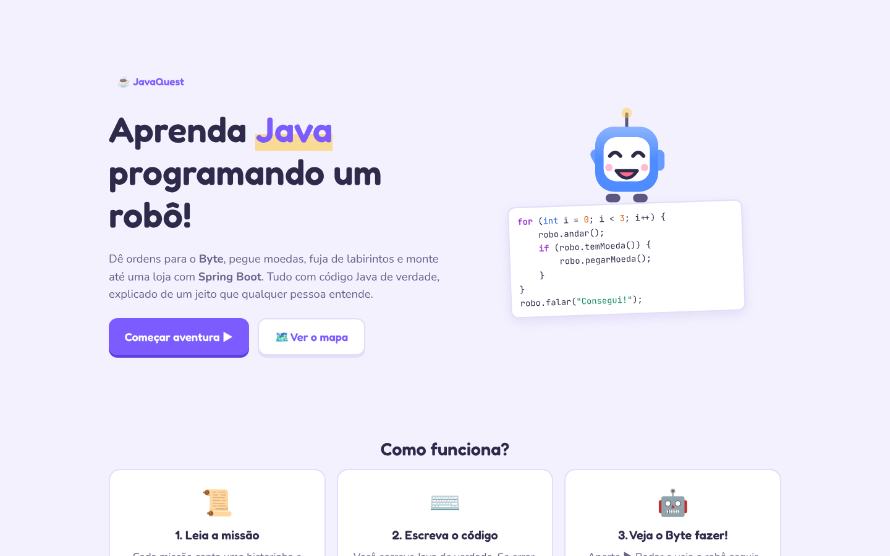
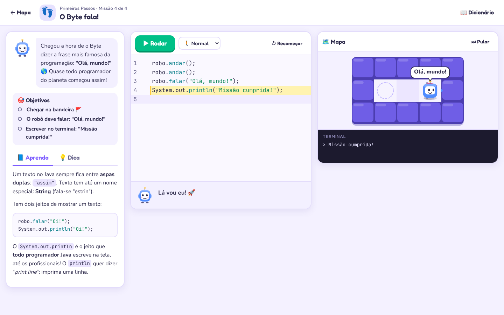
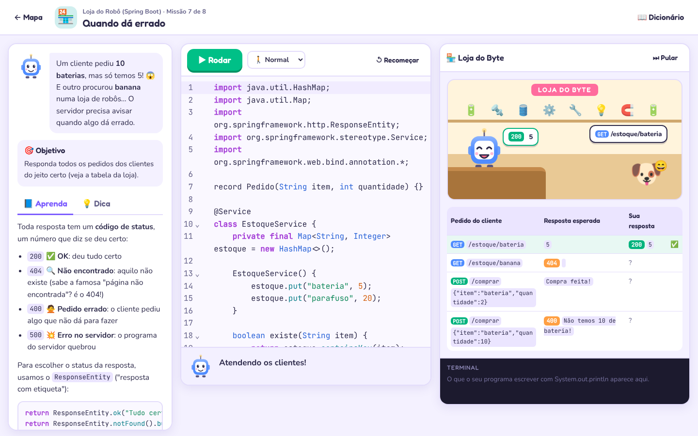

# ☕ JavaQuest: aprenda Java programando um robô

O JavaQuest é uma IDE no navegador para aprender **Java de verdade** com jogos 2D. O aluno dá ordens
para o **Byte**, um robozinho explorador, e vai da primeira linha de código até **Orientação a
Objetos**, **Spring Boot** e desafios de dados. Há também trilhas independentes de **Git** e **Docker**, com terminal simulado e revisão interativa. As explicações são escritas para que até uma criança entenda.



## Como funciona

1. **Leia a missão.** Cada missão tem uma historinha, uma explicação com exemplos e os objetivos.
2. **Escreva o código.** É Java de verdade, compilado pelo `javac`. Se der erro, o Byte explica em
   português o que aconteceu (por exemplo: *"Faltou o ponto e vírgula ; no final do comando"* ou
   *"Cuidado com maiúsculas! O certo é andar"*).
3. **Veja o Byte fazer!** O robô anda no mapa, e a linha que está rodando fica destacada no editor.



## A jornada (67 missões + modo livre)

| Módulo | O que se aprende |
|---|---|
| 👣 Primeiros Passos | comandos em sequência, `robo.andar();`, textos e `System.out.println` |
| 📦 Caixinhas de Memória | variáveis (`int`, `String`), contas e contadores |
| 🔁 Repetir é Fácil | `for`, `while` e padrões que se repetem |
| 🤔 Hora de Decidir | `if`, `else`, comparações e um labirinto |
| 🧩 Comandos Próprios | o programa completo (`class`, `main`), métodos, parâmetros e `return` |
| 📋 Listas e Arrays | arrays, `for` "para cada" e `ArrayList` |
| 🏭 Fábrica de Robôs | classes, objetos, construtores, encapsulamento, herança, polimorfismo e interfaces |
| 🏪 Loja do Robô | Spring Boot: `@RestController`, `@GetMapping`, JSON, `@PathVariable`, `@RequestParam`, `@Service`, `@PostMapping`, status HTTP e o projeto de verdade |
| 🧪 Oficina de dados do Byte | 5 missões de Strings, comparação de textos, médias, Map e Set |
| 🛟 Missões à prova de imprevistos | 3 missões de exceções, limites e processamento de pedidos |
| 🌱 Git: máquina do tempo | 6 missões de repositório, preparação, commits, diff e correção de seleção |
| 🌿 Git: missão em equipe | 6 missões de branches, merge fast-forward, tags, remoto e push |
| 🐳 Docker: porto dos contêineres | 6 missões de imagens, execução, portas, logs e ciclo de vida |
| 🚢 Docker: estação de entrega | 6 missões de Dockerfile, build, volumes e Compose |

O mapa permite **filtrar por trilha e buscar por assunto**, retomar a próxima missão e acompanhar
conquistas. A primeira missão de Java, Git e Docker começa liberada; a progressão acontece dentro de
cada trilha. As 35 missões originais continuam disponíveis com seus identificadores e progresso.

### Laboratórios de Git e Docker

São 24 atividades práticas que rodam **somente no navegador**, sem executar shell, acessar remotos,
baixar imagens ou alterar arquivos do computador. Cada missão oferece história, explicação,
objetivos acompanhados no painel, dicas, roteiro resolvido e uma pergunta de revisão. Para concluir,
é necessário cumprir os objetivos e responder corretamente. Estrelas e conquistas são salvas no
navegador; ao sair de um laboratório, o cenário é reiniciado.

O simulador implementa um subconjunto explícito dos comandos: histórico e preparação de arquivos,
branches e merge fast-forward; imagens, portas, ciclo de vida, volumes e um projeto Compose fixo.
Ele não substitui Git ou Docker reais: não simula conflitos, autenticação, rede, execução do JAR,
conteúdo persistido em bancos ou interpretação de Dockerfiles/Compose arbitrários. Os arquivos de
exemplo são consultados com `cat`, e `help` lista os comandos disponíveis. A interface identifica
as simulações e oferece links para a [documentação do Git](https://git-scm.com/docs) e a
[documentação do Docker](https://docs.docker.com/get-started/).

Algumas missões testam o código em **vários mundos** diferentes (o corredor muda de tamanho, as moedas
mudam de lugar), para o aluno aprender a escrever código que funciona em qualquer situação, e não só a
decorar a resposta. Há também o **Modo Livre** e o **Dicionário do Byte**.

Na **Loja do Robô**, os clientes chegam com pedidos HTTP e o aluno programa o atendente com as anotações
**reais** do Spring. O mesmo código funciona num projeto Spring Boot de verdade.



## Como rodar

Você precisa do **JDK 21** e do **Node.js 22.18+** (ou 24+; necessário para executar os testes TypeScript diretamente).

```bash
# 1. Construir o site
cd frontend && npm install && npm run build && cd ..

# 2. Rodar o servidor (ele já serve o site junto)
./gradlew :servidor:bootRun
```

Depois, é só abrir **http://localhost:8080**.

Para mexer no site com recarregamento automático, deixe o servidor rodando e, em outro terminal:

```bash
cd frontend && npm run dev     # abre em http://localhost:5173 e usa a API da porta 8080
```

### Com Docker

```bash
docker build -t javaquest .
docker run -p 8080:8080 --memory=1g javaquest
```

### Testes

```bash
./gradlew test
cd frontend
npm test
# Com o servidor rodando em localhost:8080:
npx playwright install chromium
npm run test:browser
```

Os testes rodam a **solução de todas as lições** e conferem se ela cumpre a missão. Eles também
conferem se o código inicial **ainda não** resolve a missão e se as proteções de segurança funcionam.

## Como é feito por dentro

```
frontend/   site em React + TypeScript (Vite), editor CodeMirror e o jogo desenhado em <canvas>
servidor/   Spring Boot 4: API, lições (YAML), compilação e execução do código dos alunos
motor/      a classe Robo, o mundo do jogo, a "mini Spring" da loja e o executor
```

Quando o aluno aperta **▶ Rodar**:

1. o servidor confere as regras da missão (por exemplo: "use um `for`");
2. compila o código com o `javac` do próprio JDK e traduz os erros para mensagens amigáveis;
3. **verifica o bytecode** compilado: o código só pode usar uma lista de classes seguras (`String`,
   `Math`, listas, o `Robo`, as anotações do Spring...). Arquivos, rede, `Runtime`, `Thread`,
   reflexão, `System.exit` e afins são bloqueados;
4. roda o programa num **processo Java separado**, com pouca memória, sem variáveis de ambiente e
   com tempo limite (loops infinitos são parados);
5. o motor devolve a lista de eventos (andou, virou, pegou moeda, falou...) com a linha do código
   de cada um, e o site anima tudo.

> **Segurança em produção:** as verificações acima protegem bem o servidor, mas, para colocar o
> JavaQuest na internet aberta, rode-o dentro de um contêiner (Docker) com limite de memória e CPU,
> como mostrado acima.

### Criar uma lição nova

As lições ficam em `servidor/src/main/resources/licoes/*.yml`. Cada lição tem `historia`,
`explicacao` (Markdown), `dica`, `codigoInicial`, `solucao`, o `mapa` (ou vários `mundos`), os
`objetivos` e, se quiser, `requisitos` sobre o código. Símbolos do mapa:

| Símbolo | Significado |
|---|---|
| `#` | parede |
| `.` | chão |
| `R` | onde um robô nasce |
| `M` | moeda |
| `F` | bandeira |

Rode `./gradlew test` para garantir que a solução funciona.

### Manter os laboratórios

- `frontend/src/laboratorio/catalogo.ts`: conteúdo, preparação de cenários, metas verificáveis e revisão.
- `frontend/src/laboratorio/motor.ts`: transições de estado e mensagens do simulador, sem efeitos externos.
- `frontend/src/pages/Oficina.tsx`: terminal, painel do ambiente e conclusão da missão.
- `frontend/tests/laboratorio.test.ts`: testa todas as soluções, cenários incompletos e erros de comandos.
- `frontend/tests/navegacao.cjs`: valida navegação, desbloqueio, persistência, revisão, execução Java e layout mobile.

O navegador junta os módulos Java recebidos da API com o catálogo local de Git/Docker. Comandos dos
laboratórios não passam pelo endpoint de compilação Java. Para testar em outro endereço, configure
`JAVAQUEST_URL`; para usar um Chromium já instalado, configure `CHROMIUM_PATH`.
